# 采购清单

> 用途：microduck制作  
> 创建日期：2026.10.01  
> 最后更新：2026.10.22

## microduck_s288版采购明细

| 序号 | 已购买 | 物品 | 数量 | 采购/复用要求 | 购买链接 | 图片 |
| --- | --- | --- | ---: | --- | --- | --- |
| A01 | ☑️ | **Raspberry Pi 5 / RDK X5** / Orange Pi 5 Pro | 1&nbsp;块 | 初期用可靠 USB-C 电源独立供电，不急着电池降压 | 待确认 | 待补充 |
| A02 | ☑️ | 系统存储 | 1&nbsp;份 | SD卡；容量按系统与日志需求选，建议预留日志空间 | 待确认 | 待补充 |
| A03 | ☑️ | **宇树 S288 无刷数字舵机** | **15&nbsp;个** | 确认型号为 S288，不是 J288；记录固件版本、序列号与订单规格 | [商品链接](https://detail.tmall.com/item.htm?abbucket=18&id=1013064765085&mi_id=0000MuavGXQPXCmho9LQ9HlWxKIGoMCxkEWMq4Nx9kFELio&ns=1&priceTId=213e074517908591765245181e193f&skuId=6140292440815&spm=a21n57.1.hoverItem.2&utparam=%7B%22aplus_abtest%22%3A%2260eabc5ce12ad79c19c9281206862fc2%22%7D&xxc=taobaoSearch) | 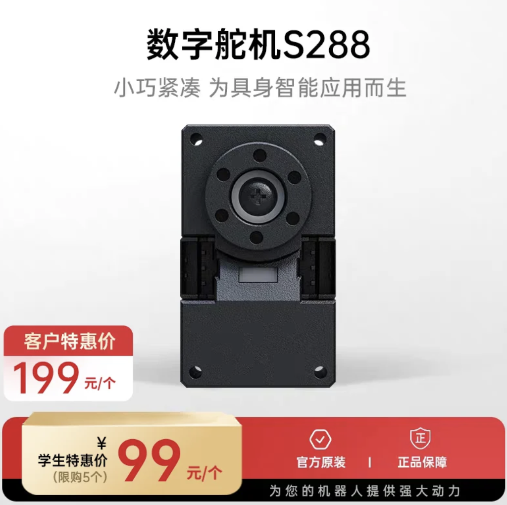 |
| A04 | ☑️ | PH2.0 舵机线 | 备用 | S288包装包含一根 PH2.0 线；买了当备用；核对实际数量、长度、脚序和额定能力 | 待填写 | 待补充 |
| A05 | ☑️ | **宇树单总线串口转 USB 板** | 1&nbsp;块 | 确认支持 J288/S288 的 6 Mbps 单总线；不是随意选一块 USB-TTL 板 | [商品链接](https://detail.tmall.com/item.htm?abbucket=18&id=1013064765085&mi_id=0000MuavGXQPXCmho9LQ9HlWxKIGoMCxkEWMq4Nx9kFELio&ns=1&priceTId=213e074517908591765245181e193f&skuId=6140292440817&spm=a21n57.1.hoverItem.2&utparam=%7B%22aplus_abtest%22%3A%2260eabc5ce12ad79c19c9281206862fc2%22%7D&xxc=taobaoSearch) | 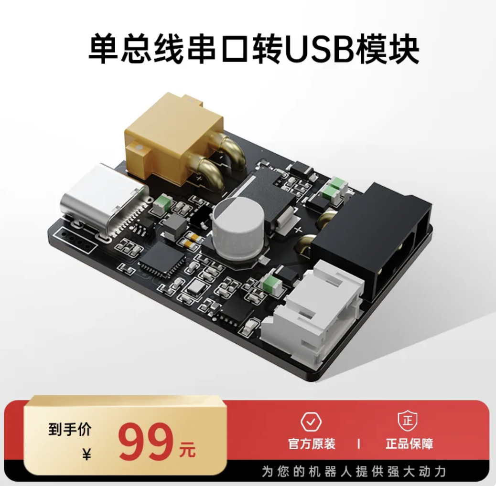 |
| A06 | ☑️ | LSM6DSV16X 六轴陀螺仪 | 1&nbsp;个 | 六轴 IMU，包含三轴陀螺仪和三轴加速度计：陀螺仪测角速度，加速度计测线性加速度及重力方向；由主控读取并融合/滤波以估计姿态，不是直接输出姿态角的模块 | [商品链接](https://item.taobao.com/item.htm?from=cart&id=712929048404&mi_id=0000dvU3vnM7aG741uGh90HSebkgVEvR_D0IrV0vJiVpt7s&skuId=6260052678408&spm=a1z0d.6639537%2F202410.item.d712929048404.21a07484X9w7sh&upStreamPrice=4300&xxc=taobaoSearch) | 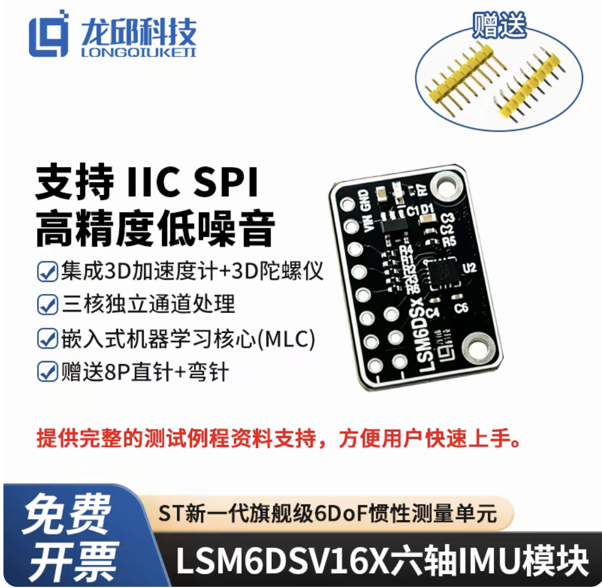 |
| A07 | ☑️ | USB转Type-C 数据线 | 1&nbsp;根 | Pi 5 的 USB-A 主机口到转接板 Type-C；须支持数据，选短线 | 无 | 无 |
| A08 | ☑️ | 2550mAh 锂电池 | 1&nbsp;块 | 先用已有 2550mAh；健康状态、极性和充电设备确认后使用 | [电池](https://detail.tmall.com/item.htm?from=cart&id=657166348854&mi_id=0000HZbtiSI6xxlw8QMsg1OZHzx-gAfPcGjYDAcyKADykJ0&skuId=4978132892218&spm=a1z0d.6639537%2F202410.item.d657166348854.267b7484CguLQC&upStreamPrice=5600&xxc=taobaoSearch) | 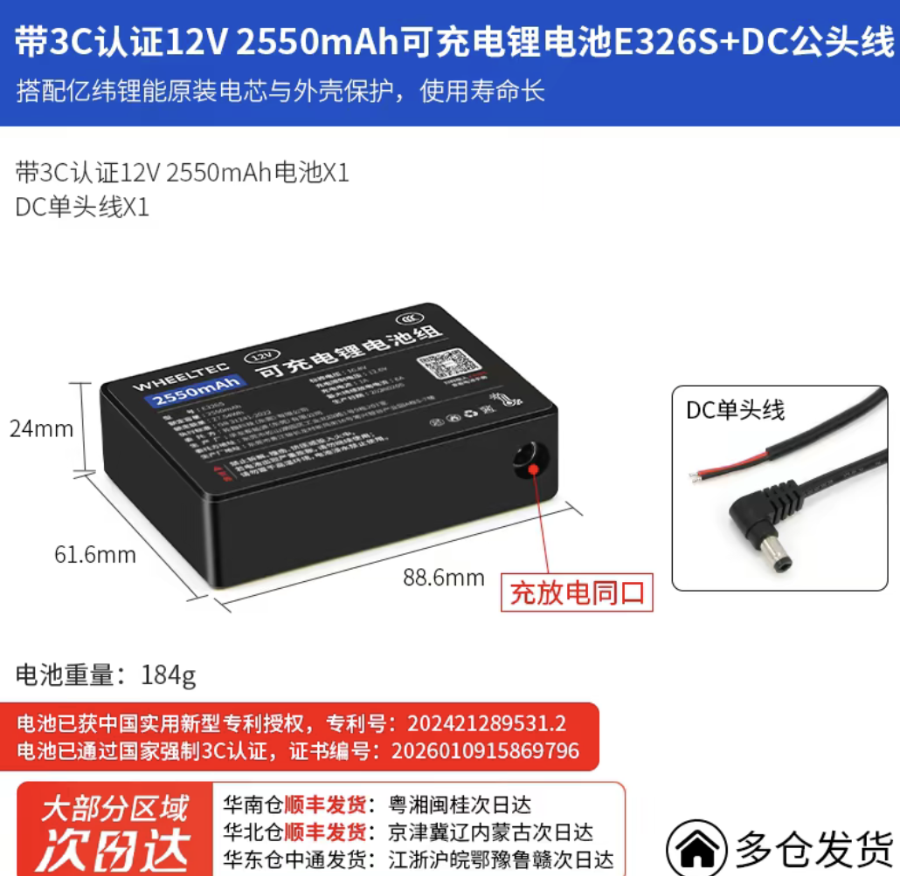 |
| A09 | ☑️ | DC5.5 弯公头转 XT30 母头线 | 1&nbsp;根 | 电池连接转接板线 | [商品链接](https://item.taobao.com/item.htm?from=cart&id=1049594755538&mi_id=0000zoGmCiD0t2aCt7nROW9YDXcEedsnvwETVnGnNa4fdeQ&spm=a1z0d.6639537%2F202410.item.d1049594755538.62857484FqjYSc&upStreamPrice=480&xxc=ad_ztc) | 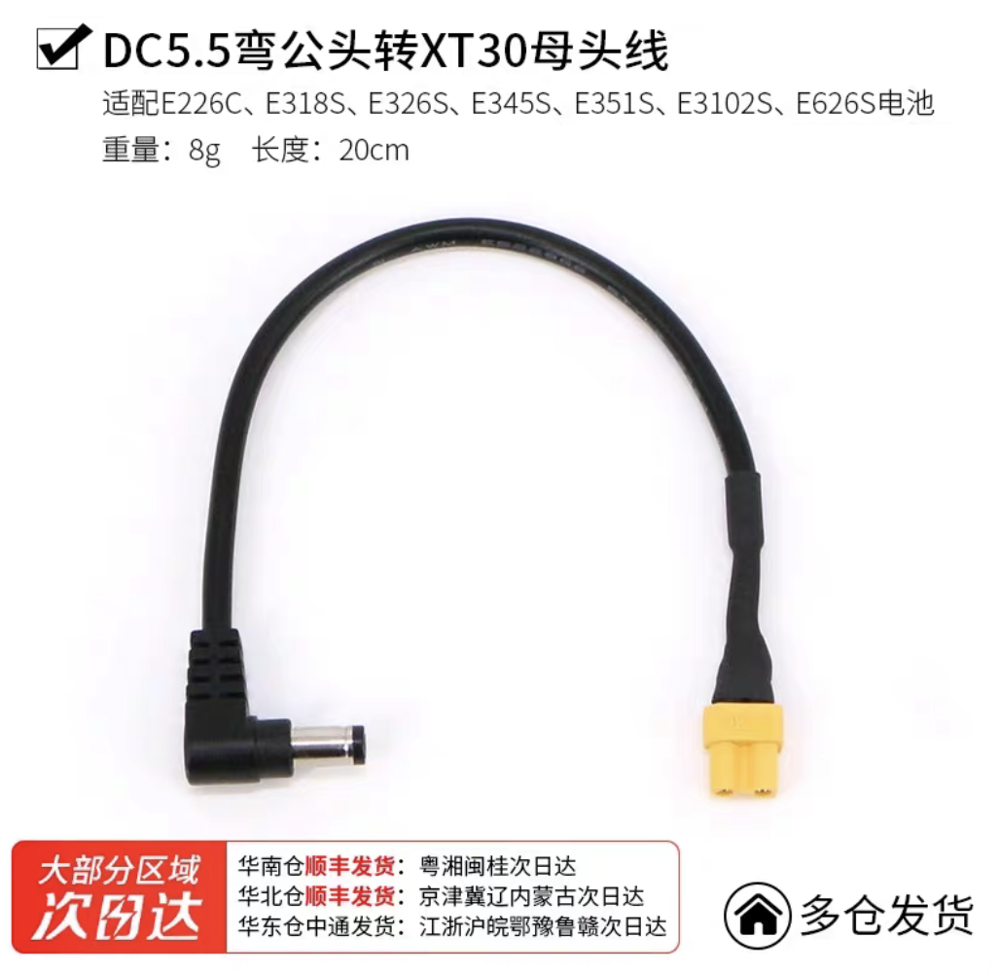 |
| A10 | ☑️ | 轴承 10×15×3 | 3&nbsp;个 | 标准件；确认内径 10 mm、外径 15 mm、厚度 3 mm，与对应结构件轴径及轴承孔尺寸匹配 | [商品链接](https://item.taobao.com/item.htm?from=cart&id=963037239628&mi_id=0000SPyU0UtHnvgsYC8n0b5gq6s09j4aTJxeZIvgVOP55Bs&skuId=6069280211062&spm=a1z0d.6639537%2F202410.item.d963037239628.6da474841aysSe&upStreamPrice=95&xxc=taobaoSearch) | 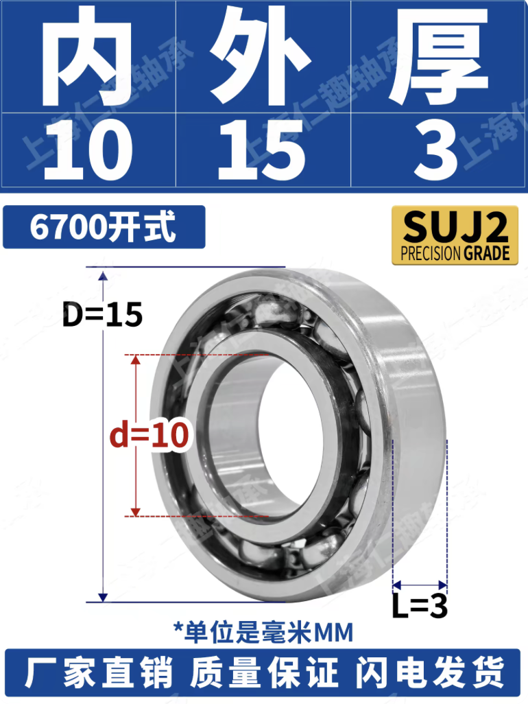 |
| A11 | ☑️ | 轴承 15×21×4 | 11&nbsp;个 | 标准件；确认内径 15 mm、外径 21 mm、厚度 4 mm，与对应关节及结构件安装尺寸匹配 | [商品链接](https://item.taobao.com/item.htm?id=982280070801&mi_id=0000bQpOR0hfrhmYiLsJtO6CCUAwn1qR12EaHQb244Xn1XE&spm=tbpc.boughtlist.suborder_itemtitle.1.2a1e2e8dyhnPQb) | 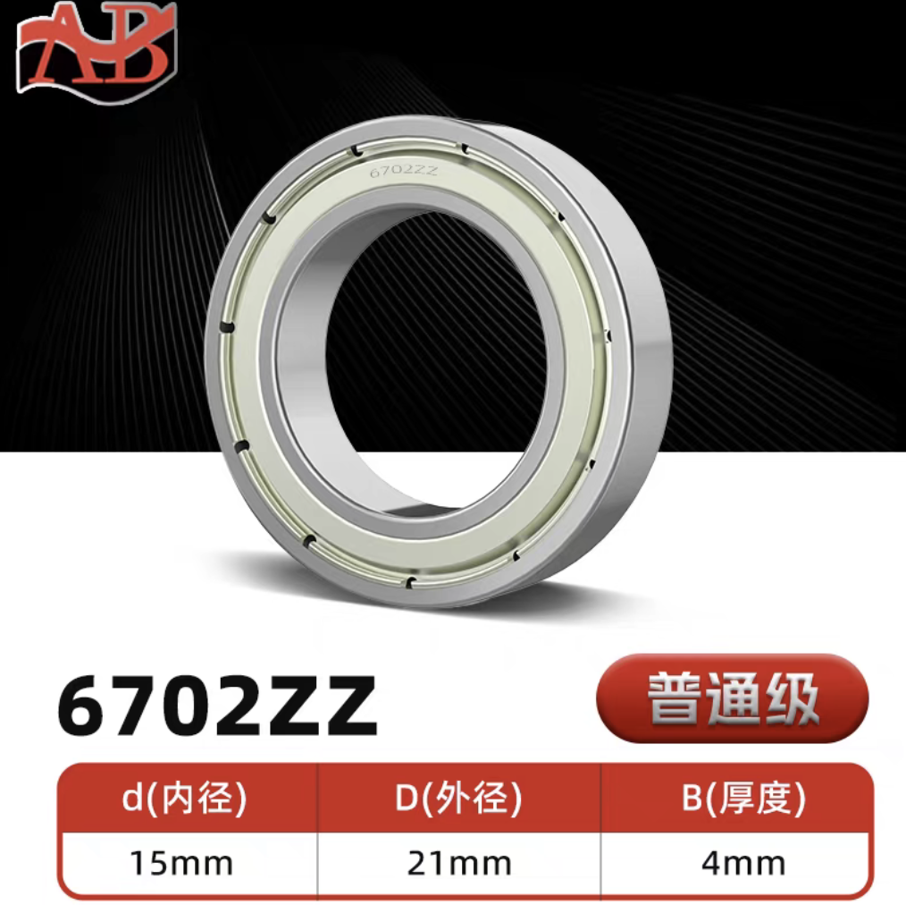 |
| A12 | ☑️ | IMX219 摄像头模块 | 1&nbsp;个 | 光学件；用于机器人视觉输入，购买时确认接口形式、排线规格、镜头视场角以及与 Raspberry Pi 5 / 所选主控的兼容性 | 待填写 | 待补充 |
| A13 | ☑️ | 螺丝M2×4 | n&nbsp;个 | 螺丝 | [商品链接](https://detail.tmall.com/item.htm?id=22060492907&mi_id=0000dV4XRzBF8LiS2MNEYU7elKInKG6V4psA7_wQMGFhl0c&spm=tbpc.boughtlist.suborder_itemtitle.1.2a1e2e8dyhnPQb) | 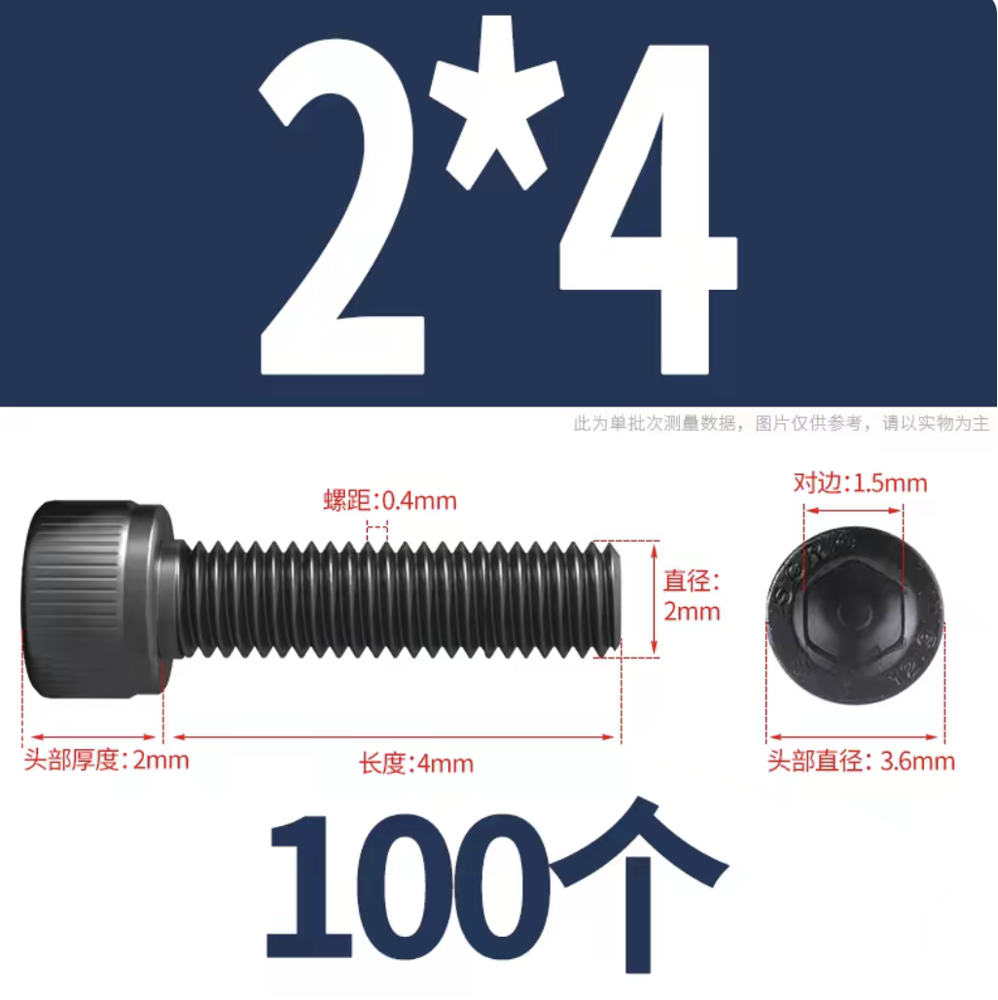 |
| A14 | ☑️ | 螺丝M2×5 | n&nbsp;个 | 螺丝 | [商品链接](https://detail.tmall.com/item.htm?id=22060492907&mi_id=0000dV4XRzBF8LiS2MNEYU7elKInKG6V4psA7_wQMGFhl0c&spm=tbpc.boughtlist.suborder_itemtitle.1.2a1e2e8dyhnPQb) | 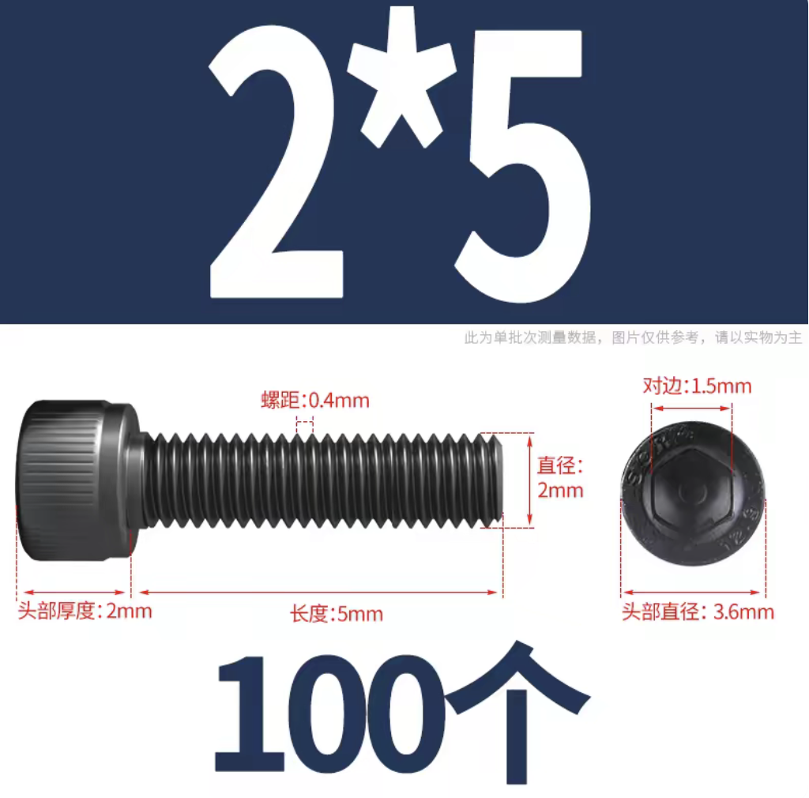 |
| A15 | ☑️ | 螺丝M2×6| n&nbsp;个 | 螺丝 | [商品链接](https://detail.tmall.com/item.htm?id=22060492907&mi_id=0000dV4XRzBF8LiS2MNEYU7elKInKG6V4psA7_wQMGFhl0c&spm=tbpc.boughtlist.suborder_itemtitle.1.2a1e2e8dyhnPQb) | 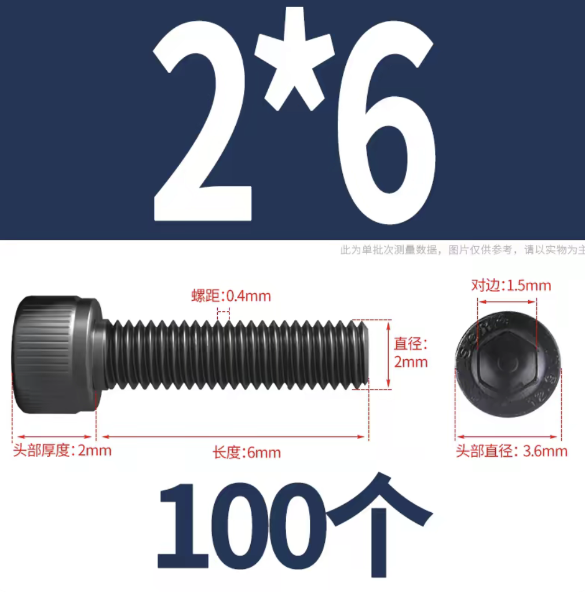 |
| A16 | ☑️ | 螺丝M2×8| n&nbsp;个 | 螺丝 | [商品链接](https://detail.tmall.com/item.htm?id=22060492907&mi_id=0000dV4XRzBF8LiS2MNEYU7elKInKG6V4psA7_wQMGFhl0c&spm=tbpc.boughtlist.suborder_itemtitle.1.2a1e2e8dyhnPQb) | 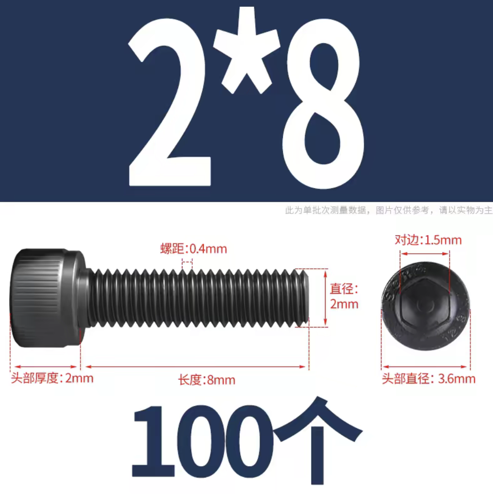 |
| A17 | ☑️ | 螺丝M2.5×10| n&nbsp;个 | 螺丝 | [商品链接](https://detail.tmall.com/item.htm?id=22060492907&mi_id=0000dV4XRzBF8LiS2MNEYU7elKInKG6V4psA7_wQMGFhl0c&spm=tbpc.boughtlist.suborder_itemtitle.1.2a1e2e8dyhnPQb) | 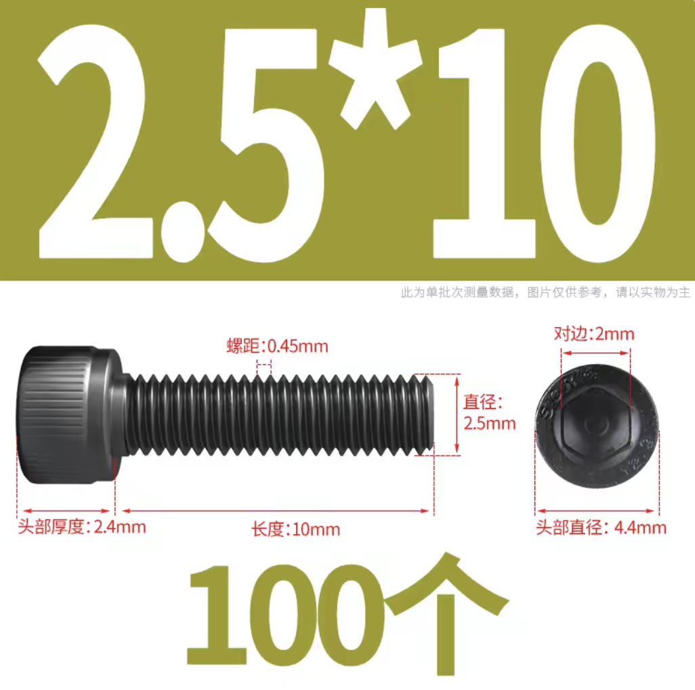 |

## 宇树S288 bam测试采购明细
| 序号 | 已购买 | 物品 | 数量 | 采购/复用要求 | 购买链接 | 图片 |
| --- | --- | --- | ---: | --- | --- | --- |
| A01 | ☑️ | 台架 | 1&nbsp;个 | 固定铝型材 | [商品链接](https://detail.tmall.com/item.htm?id=983726296158&mi_id=00005WLFFFPLnhVr-LDwD6kSLtOtdK5oV_TmteAjTHFKPu8&spm=tbpc.boughtlist.suborder_itemtitle.1.2a1e2e8dyhnPQb) | 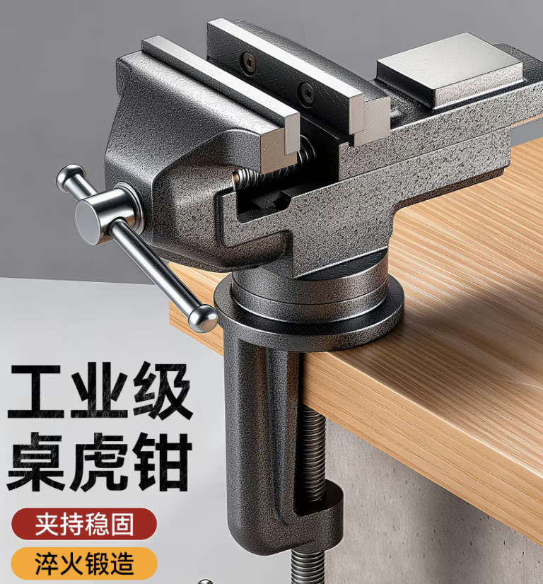 |
| A02 | ☑️ | 工业铝型材欧标3030Q-1.5新款 | 1&nbsp;个 | 铝型材 | [商品链接](https://item.taobao.com/item.htm?id=38543427846&mi_id=00006U8vLHheFzufTdHwJht2PrF0SCVjT219OBdpXzxTFK0&spm=tbpc.boughtlist.suborder_itemtitle.1.2a1e2e8dyhnPQb&skuId=6124703556913) | 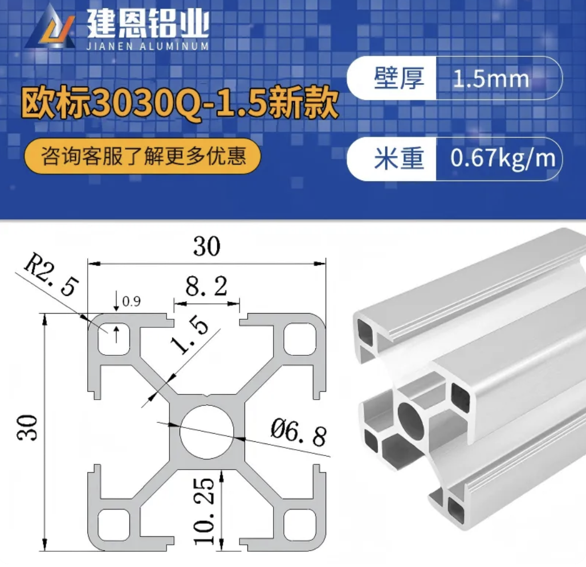 |
| A03 | ☑️ | 欧标30M6T型螺母 | 5&nbsp;个 | 装铝型材里负责固定 | [商品链接](https://item.taobao.com/item.htm?id=39417200735&mi_id=0000h0R8wUn3QrcWL85CUKggYkOiFylROGg0B4aV3rHJwQo&spm=tbpc.boughtlist.suborder_itemtitle.1.2a1e2e8dyhnPQb) | 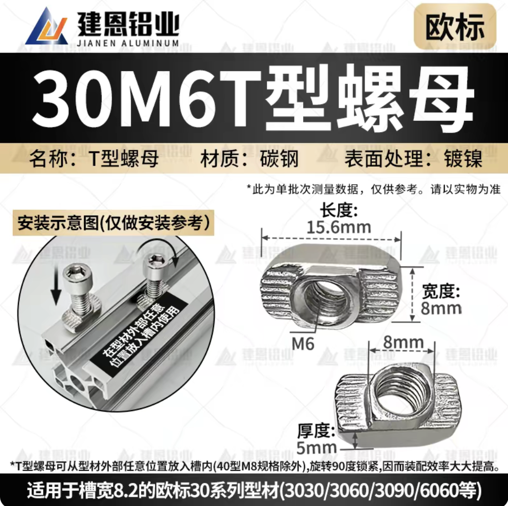 |
| A04 | ☑️ | M6*10内六角螺栓+垫片 | 5&nbsp;套 | 螺母配对螺丝 | [商品链接](https://item.taobao.com/item.htm?id=561118585548&mi_id=00002Q9hHIhfw2RzpLcuumSl4JPbUc2hUwyxTtqjrqbF56s&spm=tbpc.boughtlist.suborder_itemtitle.1.2a1e2e8dyhnPQb) | 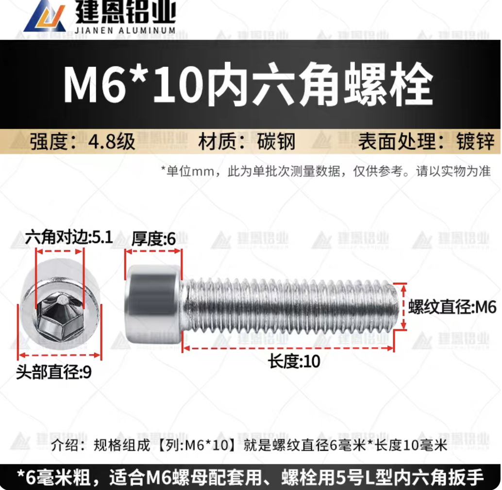 |
| A05 | ☑️ | 钢镀铬50g（直径25mm内径4-5mm） | 4&nbsp;个 | 砝码来进行bam测试 | [商品链接](https://item.taobao.com/item.htm?id=907932691903&mi_id=0000kbOfW9r1WolE3YLHhyza_D4sM89M4BMhVTCjBcvl4Mw&spm=tbpc.boughtlist.suborder_itemtitle.1.2a1e2e8dyhnPQb) | 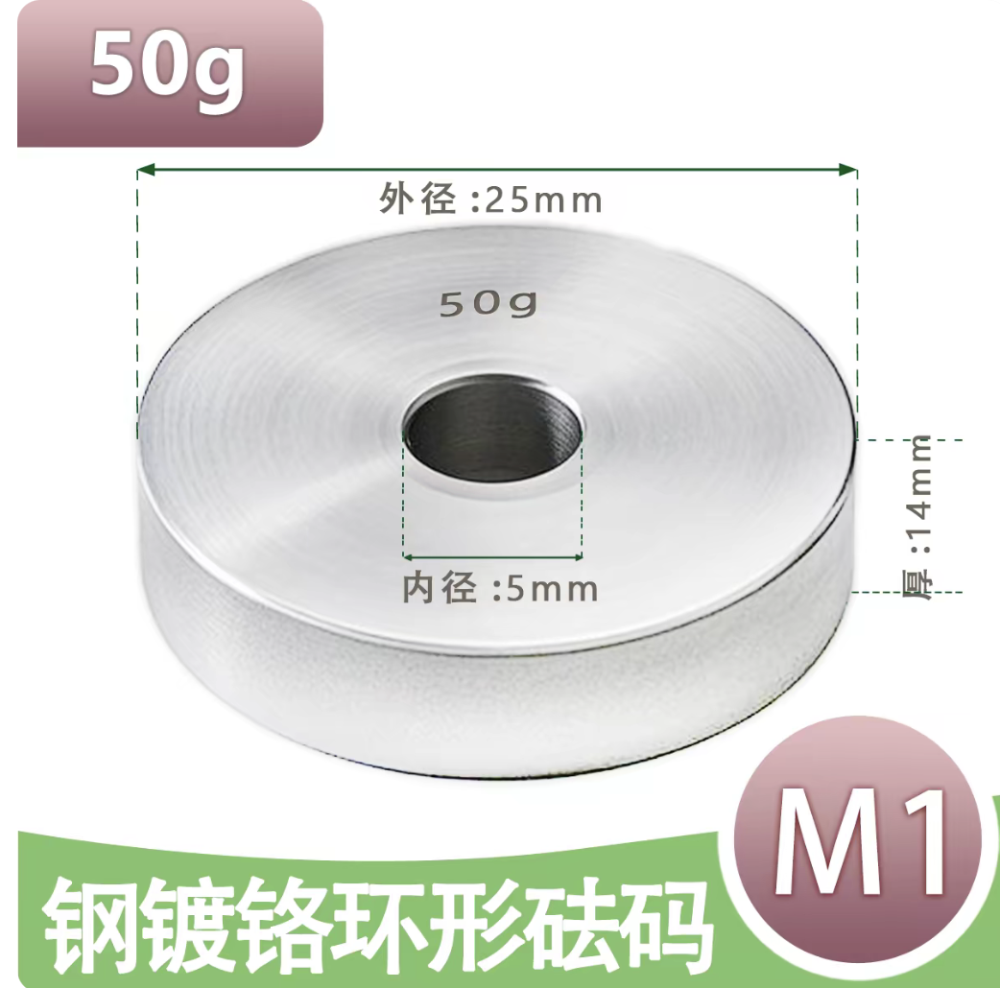 |
| A06 | ☑️ | 螺丝M4*60 | 5&nbsp;个 | 固定砝码和打印件 | [商品链接](https://detail.tmall.com/item.htm?id=684328822068&mi_id=00009Th0hWBJu0dXDsgjLiUoou2k6Y64z0MNU29elxFNIc4&spm=tbpc.boughtlist.suborder_itemtitle.1.2a1e2e8dyhnPQb) | 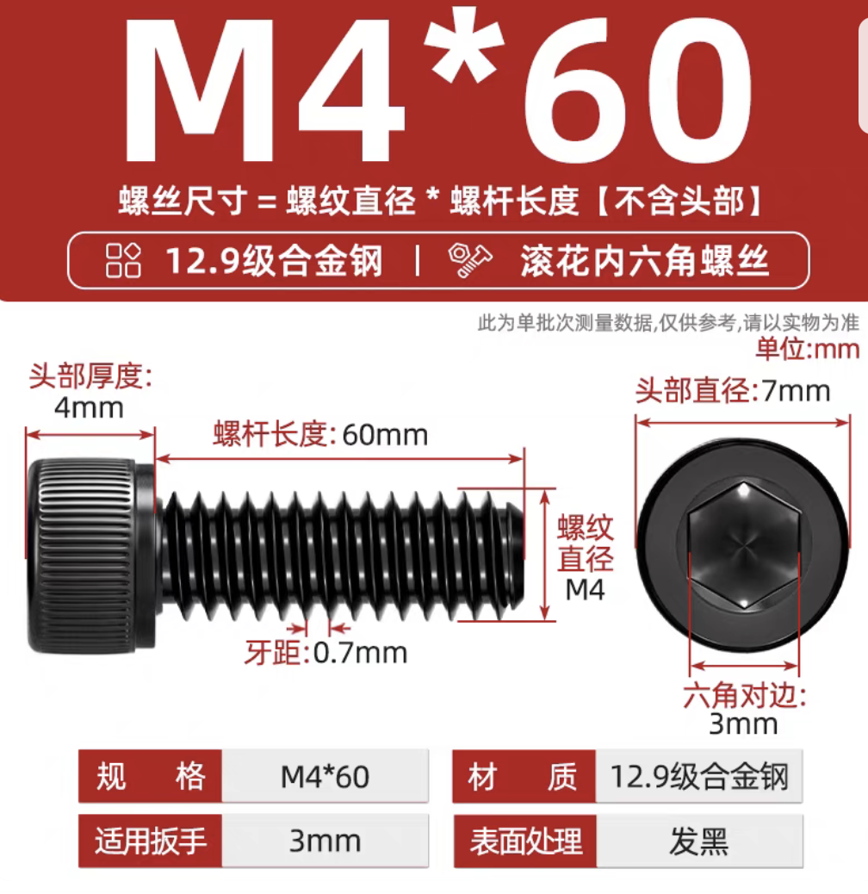 |
| A07 | ☑️ | 螺母M4 | 5&nbsp;个 | 固定砝码和打印件 | [商品链接](https://detail.tmall.com/item.htm?id=854734849605&mi_id=0000khZ_PNZ-VmcuPTPqu6bu2zhhHReBBVQ6whuDcFJ-hjk&spm=tbpc.boughtlist.suborder_itemtitle.1.2a1e2e8dyhnPQb) | 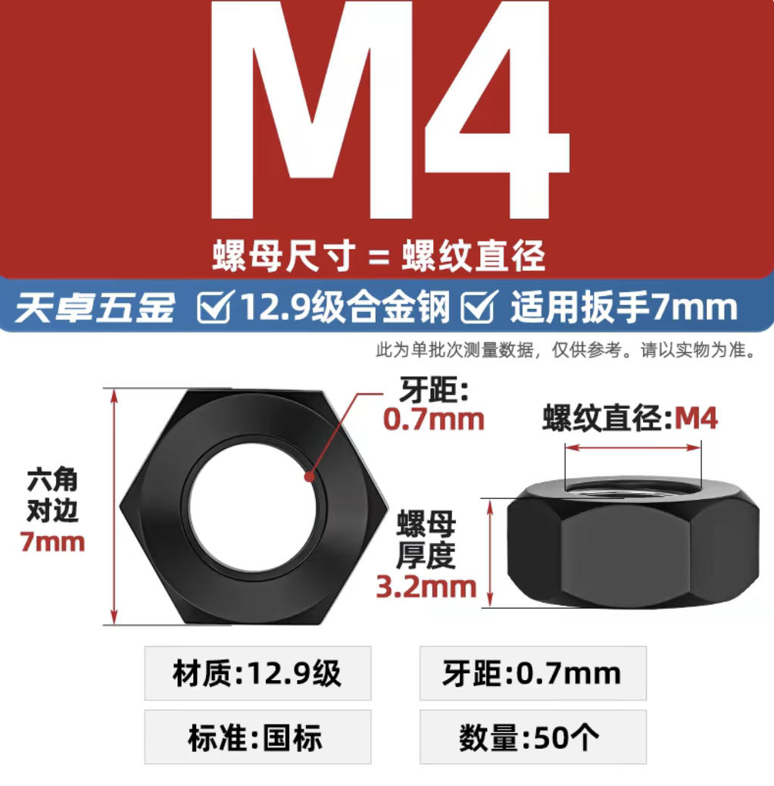 |
| A08 | ☑️ | 螺丝M4*70 | 5&nbsp;个 | 固定砝码和打印件 | [商品链接](https://detail.tmall.com/item.htm?id=684328822068&mi_id=00009Th0hWBJu0dXDsgjLiUoou2k6Y64z0MNU29elxFNIc4&spm=tbpc.boughtlist.suborder_itemtitle.1.2a1e2e8dyhnPQb) | 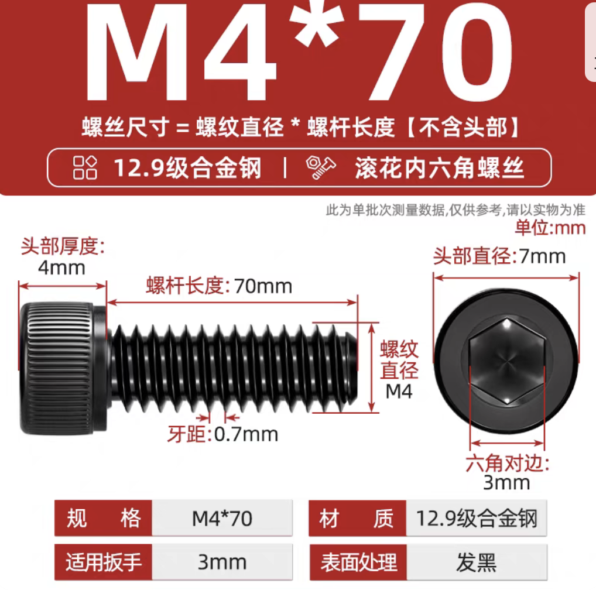 |

## 一些额外的采购记录
| 序号 | 已购买 | 物品 | 数量 | 采购/复用要求 | 购买链接 | 图片 |
| --- | --- | --- | ---: | --- | --- | --- |
| A01 | ☑️ | 热缩管绝缘套 | 1&nbsp;盒 | 热缩管 | [商品链接](https://detail.tmall.com/item.htm?id=1058588981450&mi_id=0000Gw7s8TEGWH_l4ov3b31EN8qp35_wh-I3gnn1MyYVWEI&spm=tbpc.boughtlist.suborder_itemtitle.1.28c82e8dgxWLm4) |  |
| A02 | ☑️ | 锡丝 | 1&nbsp;卷 | 安立信环保无铅焊锡丝0.8mm松香芯低温维修焊接1.0焊丝高标准锡线 | [商品链接](https://detail.tmall.com/item.htm?id=588626885887&mi_id=0000hL1CVDKsyjUS0W52QlxFyfe1Avo6tQ27asRXEUUxc-g&spm=tbpc.boughtlist.suborder_itemtitle.1.28c82e8dgxWLm4) |  |
| A03 | ☑️ | Ｔ12-K刀头 | 1&nbsp;个 | 国产全新Ｔ12-K刀头 | [商品链接](https://item.taobao.com/item.htm?id=538331039401&mi_id=00007ns-JN_E8I1UiooJG2lS0X1dmyeYpXT5wjhXKm2r23E&spm=tbpc.boughtlist.suborder_itemtitle.1.28c82e8dgxWLm4) |  |
| A04 | ☑️ | 222/50ml紫色【低强度/易拆卸/适合小螺丝】胶水 | 1&nbsp;瓶 | 德国螺丝胶螺纹胶防松紧固胶 | [商品链接](https://detail.tmall.com/item.htm?id=948551841449&mi_id=0000vgZ8wYiNdvoVOCB22TcbI7JGot6ZF3Qh-26XPBssLeg&spm=tbpc.boughtlist.suborder_itemtitle.1.28c82e8dgxWLm4) |  |
| A05 | ☑️ | PH2.0 公壳 3P | 50&nbsp;个 | PH2.0空中对接母壳间距2mm公头 | [商品链接](https://detail.tmall.com/item.htm?id=867045399309&mi_id=0000o9EidTAEKSdD5CxlhNE0LNorCly29o0-uNHdTd6mzQw&spm=tbpc.boughtlist.suborder_itemtitle.1.28c82e8dgxWLm4) |  |
| A06 | ☑️ | PH母端子（适用公壳） | 100&nbsp;个 | PH2.0空中对接母壳间距2mm公头 | [商品链接](https://detail.tmall.com/item.htm?id=867045399309&mi_id=0000o9EidTAEKSdD5CxlhNE0LNorCly29o0-uNHdTd6mzQw&spm=tbpc.boughtlist.suborder_itemtitle.1.28c82e8dgxWLm4) |  |
| A07 | ☑️ | SN-01BM 压线钳 | 1&nbsp;个 | 适用于xh2.54和ph2.0 | [商品链接](https://detail.tmall.com/item.htm?id=636355793775&mi_id=0000UOFNQr93Lril2i3w9Gp41FlVzDLdZaYz22nQuBNHoL0&spm=tbpc.boughtlist.suborder_itemtitle.1.28c82e8dgxWLm4) |  |
| A08 | ☑️ | 7寸多功能压接剥线钳 | 1&nbsp;个 | 剥线钳 | [商品链接](https://detail.tmall.com/item.htm?id=848681225542&mi_id=0000cGTQTaai50V7exxVVRxqj891in-AJQbSmneI_h73KBU&spm=tbpc.boughtlist.suborder_itemtitle.1.28c82e8dgxWLm4) |  |
